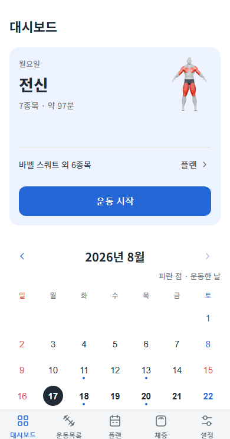
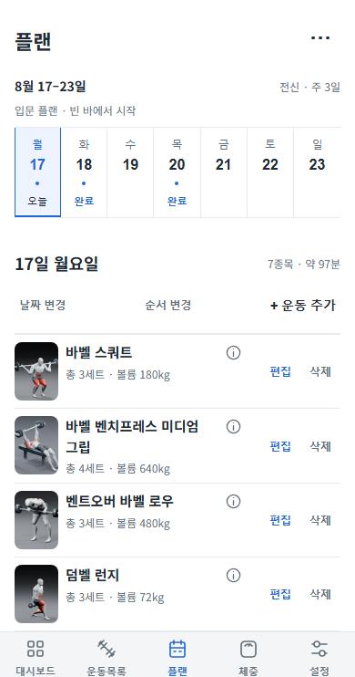
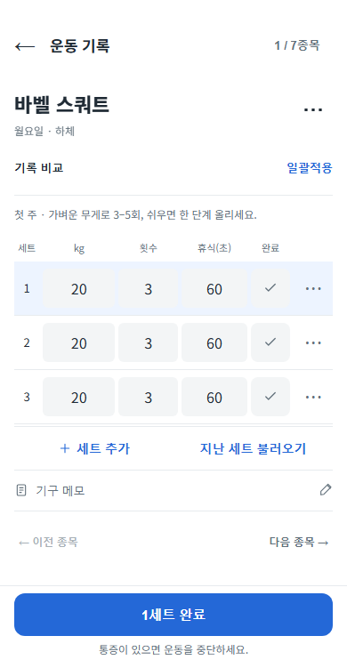
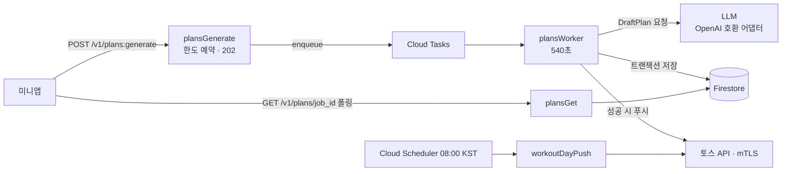
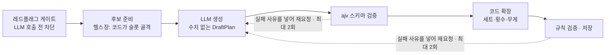

# 번위크 백엔드

> LLM이 짜 준 주간 운동 플랜을, 검증을 통과한 것만 사용자에게 보내는 토스 미니앱 백엔드


<p>
  
  
  
</p>

- **서비스**: 목표·주 운동 일수·장소를 고르면 LLM이 월~일 플랜을 만들고, 실행 기록이 다음 주 처방에 반영됩니다. 토스 앱 안의 미니앱 플랫폼(앱인토스)에 2026.09 정식 출시해 운영 중입니다.
- **이 저장소**: 운영 저장소의 `backend/`와 결정 기록을 옮긴 공개본입니다. 테스트는 이 저장소만으로 전부 돌아갑니다. 미니앱 프런트엔드, 진행 중 작업 메모, 배포 설정의 계정 정보는 싣지 않았습니다.
- **담당**: 기획, API 설계, 데이터 모델링, LLM 파이프라인, 배포, 운영. 구현에는 Claude Code를 썼습니다([개발 방식](#개발-방식)).

## 핵심 설계 세 가지

1. **접수와 생성을 큐로 분리** — LLM 응답이 수십 초에서 수 분까지 걸려서, 요청은 202로 받고 생성은 Cloud Tasks 워커가 합니다. 앱은 잡 상태를 폴링하고, 성공하면 토스 푸시도 받습니다. ([ADR-0011](docs/decisions/0011-async-plan-generation.md))
2. **세트·횟수·무게는 항상 코드가** — LLM은 종목 구성만 맡습니다. 헬스장 환경은 코드가 만든 슬롯 후보 중에서 고르게 하고(P1), 그 밖 환경은 LLM이 종목을 구성합니다(P0). 출력은 ajv 스키마와 운동 규칙으로 두 번 거르고, 각 단계에서 실패 사유를 넣어 최대 2회씩 다시 요청합니다(최초 포함 최대 5회 호출). ([ADR-0006](docs/decisions/0006-provider-agnostic-llm-adapter.md) · [ADR-0025](docs/decisions/0025-generation-pipeline-p1.md) · [`config.ts` L47-L51](backend/src/config.ts#L47-L51))
3. **실패해도 한도가 꼬이지 않게** — 생성 한도 예약·정산·환불을 Firestore 트랜잭션으로 묶고, 잡 상태 전이(`queued → running → ok|error`)로 중복 실행과 늦게 온 워커의 저장을 막습니다. 아래 표 참고.

## 구조



함수 6개(`authToss`, `tossWithdraw`, `plansGenerate`, `plansWorker`, `plansGet`, `workoutDayPush`)가 모두 서울 리전에 있습니다. Firestore 보안 규칙은 클라이언트 접근을 전부 막고, 함수의 Admin SDK로만 읽고 씁니다([`backend/firestore.rules`](backend/firestore.rules)).

### 생성 파이프라인



본체는 [`backend/src/generation/handler.ts`](backend/src/generation/handler.ts)(단계별 예산 [L80-L84](backend/src/generation/handler.ts#L80-L84)), 스키마는 [`backend/src/schemas/`](backend/src/schemas)에 있습니다.

## 비동기 처리의 실패 경로

| 상황 | 처리 | 코드 | 테스트 |
|---|---|---|---|
| 한도 예약 후 큐 등록 실패 | 잡이 아직 `queued`일 때만 트랜잭션으로 한도 환불 + `error` 기록. 복구마저 실패하면 예약 만료(20분) 뒤 다음 요청 때 환불 | [index.ts L509-L526](backend/src/index.ts#L509-L526) · [access.ts](backend/src/generation/access.ts) | `queue failures refund free and reward reservations without granting twice` |
| 같은 잡의 중복 실행 | 큐 재시도 없음(`maxAttempts: 1`, 재요청은 파이프라인 안에서). 워커는 `queued → running` 전이 트랜잭션에 성공했을 때만 실행 | [index.ts L542](backend/src/index.ts#L542) · [L553-L561](backend/src/index.ts#L553-L561) | `stale jobs release the account and late workers cannot save or refund again` |
| 생성이 마감 시간을 넘김 | 플랫폼 종료 15초 전에 기다리기를 끝내고 `error` 기록·한도 환불을 확정. 진행 중인 LLM 호출은 취소하지 않으며 늦게 온 결과는 저장되지 않음([#5](https://github.com/YoungkeunAhn/burnweek-backend/issues/5)). 토스 푸시는 성공 때만 보내므로 앱은 폴링으로 실패를 확인 | [index.ts L116-L146](backend/src/index.ts#L116-L146) · [L723-L726](backend/src/index.ts#L723-L726) | `ends an over-budget job as error + failure push instead of leaving it running` |
| 저장 후 푸시 실패 | 커밋한 뒤에 푸시하므로 플랜과 정산은 그대로. 실패는 로그만 남김 | [index.ts L723-L741](backend/src/index.ts#L723-L741) | 직접 주입하는 테스트 없음 |

테스트는 모두 [`backend/test/generation-api-contract.test.ts`](backend/test/generation-api-contract.test.ts)에 있습니다. 마감 테스트의 "failure push"는 레거시 FCM 클라이언트 경로이며, 미니앱은 FCM 토큰이 없어 폴링만 씁니다.

## 기술적 의사결정

| 결정 | 검토한 대안 | 채택 | 근거 |
|---|---|---|---|
| 생성 요청 처리 | 동기 응답(p95 60초 목표) | 202 접수 + Cloud Tasks 워커 + 폴링 | POC에서 응답 31~68초, 앱이 백그라운드로 가면 요청이 끊김 · [ADR-0011](docs/decisions/0011-async-plan-generation.md) |
| 꼬리 지연 | 추론 끄기 (12종×3회 A/B에서 p90 182.7초 → 32.7초) | 추론 유지 + 워커 540초 + 자체 마감 | 추론을 끄면 하드 게이트 통과 32/36 → 17/36 · [ADR-0016](docs/decisions/0016-generation-timeout-and-compact-draft.md) · [원자료](backend/test/results/reasoning-ab-2026-09-23.json) |
| 종목 구성 | LLM 자유 구성(P0)만 | 헬스장만 코드 골격 + 슬롯 선택(P1) | 헬스장 프로필에서만 P1이 이김. 그 밖 환경은 근거가 없어 P0 유지 · [ADR-0025](docs/decisions/0025-generation-pipeline-p1.md) |
| 런타임 | Cloudflare Workers + Hono(조사 추천안) | Firebase Functions Gen2 | 콜드스타트(1~12초)를 감수하고 무료 쿼터 선택. Blaze 필수가 드러난 뒤에도 실청구 0원·이전 비용으로 유지 · [ADR-0008](docs/decisions/0008-backend-runtime-firebase.md) |
| 운동 미디어 | 앱 번들 / Firebase Storage | Cloudflare R2 + 해시 불변 URL | 번들 99,045,191 bytes로 100MB 한도 근접, 전송비 · [ADR-0026](docs/decisions/0026-exercise-media-on-r2.md) |

읽는 순서는 [`docs/README.md`](docs/README.md)에 정리했습니다.

## 트러블슈팅

| 문제 | 원인 | 해결 |
|---|---|---|
| 실기기 토스 로그인이 전부 401 | 확인 스크립트는 PEM, 함수는 RC2-40 암호화 p12 → Node 22(OpenSSL 3)가 거부 | 변환 단계를 없애고 PEM 하나로 통일 |
| 헬스장 플랜 생성이 전부 실패 | 접수와 워커가 후보 목록을 각자 만들어, P1 결과를 옛 허용 목록이 거부 | `prepareGeneration` 공유 + 회귀 테스트 17건 |
| TTL이 안 걸려 데이터가 계속 쌓임 | `expires_at`을 ISO 문자열로 저장 | Date 타입으로 수정, 삭제 경합 10건 함께 정리 |
| 프로덕션에서만 조회 API 500 | 내림차순 정렬에 복합 색인 필요 | 기본 색인 오름차순으로 읽고 뒤에서 자름 |

원인 분석과 재현 과정은 [`docs/troubleshooting.md`](docs/troubleshooting.md)에 있습니다.

## 이 저장소에 대해

운영 저장소는 비공개입니다. 여기에는 설계를 설명하는 문서와, 그 설명이 가리키는 핵심 코드·테스트만 옮겼습니다. 빌드·실행에 필요한 나머지 코드는 넣지 않아 이 저장소만으로는 실행되지 않습니다.

테스트는 운영 저장소에서 Vitest 885개가 통과합니다(2026-10-26 기록). Firestore·토스 API·LLM을 테스트 더블과 로컬 가짜 서버로 대체해 키나 에뮬레이터 없이 돕니다.

## 개발 방식

구현은 Claude Code로 하고, 방향과 검증은 직접 정합니다. 결정 기록에 나오는 "사용자 결정"은 에이전트와 문서를 함께 쓰면서 남긴 표현으로, 제 결정을 뜻합니다. 예를 들면:

- 런타임은 조사 단계에서 Cloudflare Workers를 추천받았지만 무료 쿼터를 보고 Firebase로 정했고, 결제 수단 등록(Blaze)이 필수라는 게 드러난 뒤에도 유지했습니다([ADR-0008](docs/decisions/0008-backend-runtime-firebase.md)).
- 최소 인스턴스 1개 유지는 30일 유휴비 $17.46~22.68로 계산된 뒤 승인하지 않았습니다.

코드 주석의 `codex N2 R1` 같은 표기는 다른 공급사 모델로 교차 리뷰한 라운드 기록입니다. 리뷰 결과를 반영할지는 직접 판단하고, 테스트와 실기기로 확인했습니다.

## 알려진 결함

- [#1](https://github.com/YoungkeunAhn/burnweek-backend/issues/1) 워커 시작 트랜잭션의 모든 실패를 "사용자 삭제"로 처리 — 일시적인 DB 오류도 정상 종료돼, 잡이 `queued`로 남고 환불이 20분 늦어집니다.
- 플랫폼이 워커를 강제로 끝내면(메모리 초과 등) 잡이 `running`으로 남고, 20분 예약 만료 뒤에야 정리됩니다.
- [#2](https://github.com/YoungkeunAhn/burnweek-backend/issues/2) 워커 완료 로그를 결과 저장 전에 남김 — 저장이 실패해도 로그에는 성공으로 남아, 로그로 보는 실패율이 실제보다 낮게 나옵니다.
- [#3](https://github.com/YoungkeunAhn/burnweek-backend/issues/3) 실제 LLM 검증 스크립트(`verify:live`)가 생성 실패에도 종료 코드 0
- [#4](https://github.com/YoungkeunAhn/burnweek-backend/issues/4) 완료 기록이 있는 주를 재생성하면 잡 조회와 현재 플랜 조회가 다른 플랜을 반환할 수 있음 — 잡에는 병합 전 플랜이 저장됨
- [#5](https://github.com/YoungkeunAhn/burnweek-backend/issues/5) 마감 후에도 진행 중인 생성 작업과 LLM 호출이 취소되지 않음
- 저장 후 푸시 실패를 직접 주입하는 테스트가 없습니다.

## 저장소 구성

```
backend/
  src/index.ts                  함수 6개 (접수·워커·조회·로그인·탈퇴·예약 푸시)
  src/config.ts                 파이프라인 분기(P0·P1)
  src/generation/access.ts      생성 한도 예약·정산·환불 트랜잭션
  src/generation/handler.ts     LLM 호출·스키마 검증·재요청
  src/generation/prepare.ts     접수와 워커가 함께 쓰는 후보 준비
  src/auth/                     토스 mTLS 로그인, 계정 버전
  src/schemas/                  ajv JSON Schema 2020
  firestore.rules               클라이언트 직접 접근 차단
  test/                         계약 테스트, mTLS 로컬 서버, LLM 심판 하네스
  test/results/                 모델·추론 A/B 결과
docs/                           읽는 순서, 트러블슈팅, ADR 30건·결정 로그, 데이터 모델
```
