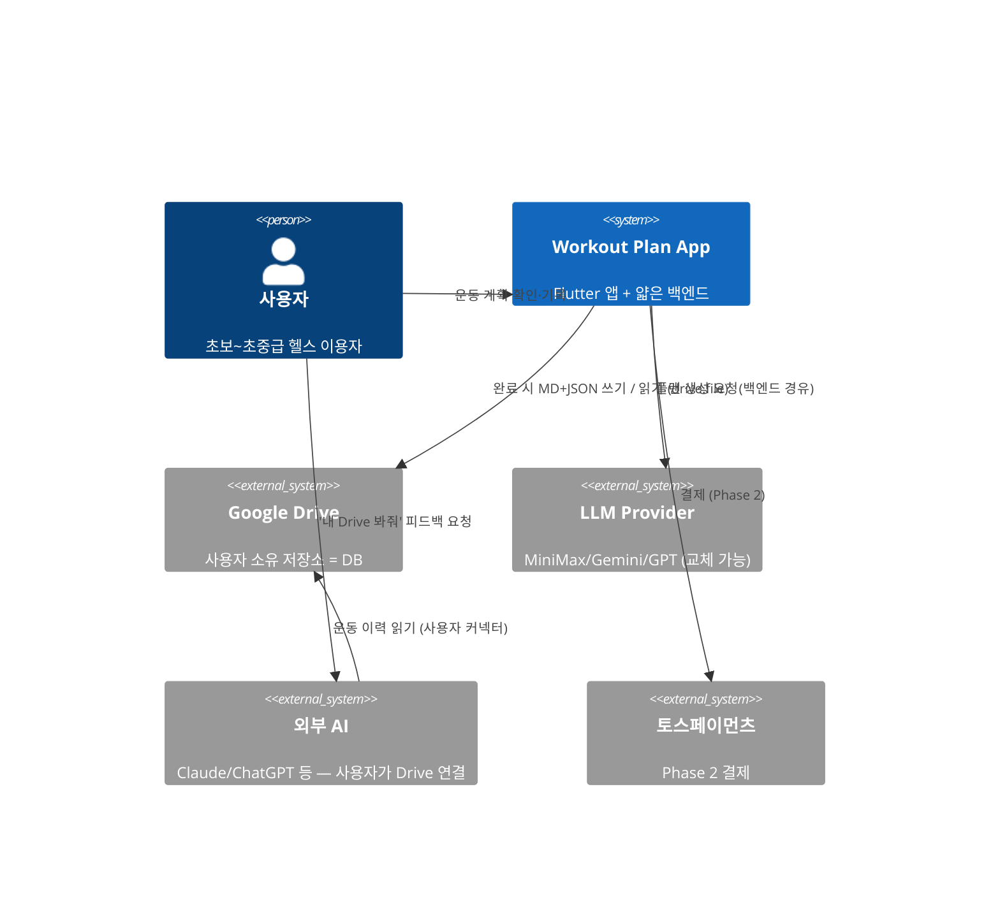
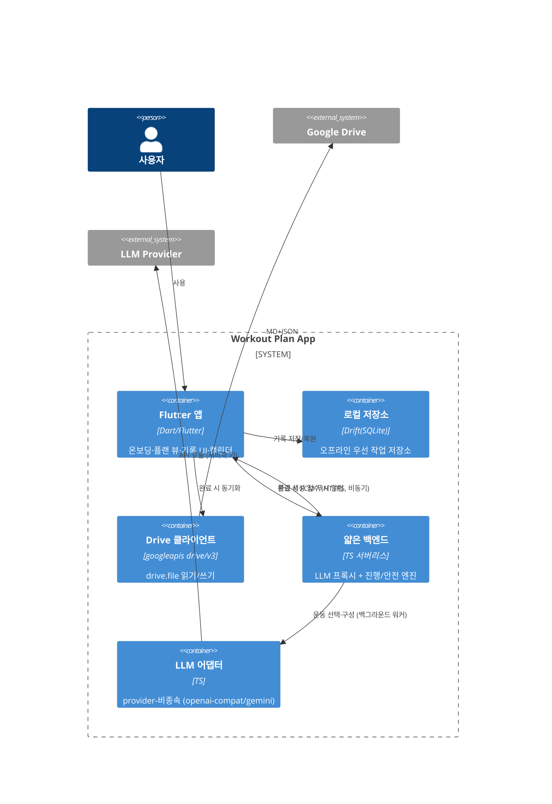

# 시스템 개요 (Architecture Overview)

- **Status:** Draft (Phase 1)
- **Date:** 2026-08-16
- **근거:** PRD, [결정 로그](../decisions/mvp-decision-log.md), research/05(arc42-lite+C4). [ADR-0001](../decisions/0001-docs-scaffolding-and-repo-structure.md)(리포 구조).

> ⏸ **이 문서는 Flutter 제품 소관이며 2026-08-20 [D16](../decisions/mvp-decision-log.md)으로 동결됐다.** 현재 진행선은 토스 미니앱이고, 저장 정본은 Firestore다([D19](../decisions/mvp-decision-log.md)). 아래의 Flutter·Drift·Drive·FCM 서술은 **재개 시 유효한 기록**으로 읽어라.

arc42-lite 섹션(§1 목표·§2 제약·§3 컨텍스트·§5 빌딩블록·§7 배포·§8 횡단·§9 결정)으로 구성. 다이어그램은 C4 Context/Container.

## §1 목표 (품질 목표 우선순위)
1. **안전** — 부상 금기·의료 면책·과부하 가드(코드 소유, INV-1/6).
2. **데이터 이식성** — 사용자 Drive에 사람·AI 읽기 가능 저장(제품 핵심 가치).
3. **비용 통제** — 주 1회 생성·캐싱·저비용 모델(D8/NFR-COST-1).
4. **provider 독립성** — LLM 교체가 설정으로 가능(D10).

## §2 제약 (Constraints)
- 클라이언트 = **Flutter**(독립 앱). 백엔드 = 얇은 서버리스(**Firebase Cloud Functions Gen2**, [ADR-0008](../decisions/0008-backend-runtime-firebase.md)).
- Google Drive 접근 = **`drive.file`** 만(INV-2). LLM 키 = **백엔드에만**(INV-3).
- LLM = provider-비종속 어댑터(테스트 MiniMax). ~~토스 미니앱 아님(D1)~~ → **D1은 [D16](../decisions/mvp-decision-log.md)이 supersede**했다(미니앱 우선).

## §3 시스템 컨텍스트 (C4 Context)



핵심: **앱은 외부 AI를 호출하지 않는다**(D5/NG2). 외부 AI는 사용자가 자기 커넥터로 Drive에 연결.

## §5 컨테이너 뷰 (C4 Container)



**비동기 생성([ADR-0011](../decisions/0011-async-plan-generation.md)·[ADR-0016](../decisions/0016-generation-timeout-and-compact-draft.md)):** 접수 즉시 `202 queued`(하드 레드플래그면 즉시 차단), 백그라운드 워커가 생성(하드 상한 540s·속도 목표 p90 60s) 후 **FCM 푸시** → 앱이 완성 플랜 인출. 인프라: Cloud Tasks(enqueue) + Firestore(GenerationJob, **ephemeral·TTL**) + FCM. 사용자는 생성 중 앱을 종료해도 알림 수신.

**책임 분담(D11):** `llmAdapter`→LLM은 **DraftPlan(운동 선택·구성, 수치 없음)** 만. `backend`의 확장·진행·안전 엔진(코드)이 이를 **WeeklyPlan v1로 확장**하며 **1RM·무게·볼륨·증량·금기·상한 계산·검증**([02-data-model §B](./02-data-model.md)). 앱은 표시·기록·Drive 쓰기.

## §7 배포 (Deployment)
- **앱:** App Store / Play Store(독립 Flutter).
- **백엔드:** **Firebase Cloud Functions Gen2** ([ADR-0008](../decisions/0008-backend-runtime-firebase.md)). 비밀키는 `defineSecret`(Secret Manager). 핸들러는 config를 **주입받도록** 작성해 런타임 이식성 확보(Hono 라우터 선택). **비동기 생성**(ADR-0011): 접수 함수 + **Cloud Tasks**(`onTaskDispatched`) 워커 + **FCM** 푸시.
- **저장:** 사용자 Google Drive(백엔드에 영구 운동 이력 DB 없음 — NFR-PRIV-1). 생성 잡은 **Firestore ephemeral(TTL 자동삭제)** 로만 일시 보관(ADR-0011).

## §8 횡단 관심사 (Cross-cutting)
- **보안:** LLM 키 백엔드 전용(INV-3); Google OAuth = Auth Code + PKCE, 시스템 브라우저, 콘센트 Production(NFR-AUTH-1).
- **프라이버시:** Drive가 원본, 백엔드는 생성 컨텍스트 최소 처리(NFR-PRIV-1).
- **안전 — 생성 게이트:** 백엔드는 **LLM 호출 이전에** 하드 레드플래그([02-data-model 택소노미](./02-data-model.md))를 판정해 true면 LLM 호출 없이 차단(FR-SAFE-3, 우회 불가). 이후 코드가 수치·금기·볼륨 상한 검증 + 면책 포함(FR-SAFE-1). 저위험은 경고 + 부위 금기 반영(FR-SAFE-4).
- **비용:** 주 1회 생성 + 프롬프트 캐싱(NFR-COST-1). 상세 [03-llm-adapter](./03-llm-adapter.md).
- **오프라인:** 로컬 우선, 완료 시 동기화, 실패 시 무손실 재시도(FR-SYNC-3/6).

## §9 아키텍처 결정
[decisions/](../decisions/00-START-HERE.md) 참조. 큰 결정은 D1–D11(mvp-decision-log) + ADR로 분화 예정(0002~).

## 데이터 흐름 요약
[mvp-decision-log 하단 흐름도](../decisions/mvp-decision-log.md) 및 [02-data-model](./02-data-model.md) 참조.
```
온보딩 → [접수 202 queued] → [백엔드 워커(비동기): LLM 운동선택 + 코드 수치·안전] → FCM 푸시 → 앱이 주간 플랜 인출·로컬 저장
  → 주중: 로컬 기록(수동 조정) → 완료 시 Drive(MD+JSON)
  → 사용자가 외부 AI에 Drive 연결(피드백)
  → 주말: 로컬 로그 → 백엔드 → 다음 주 생성(피드백 루프)
```
